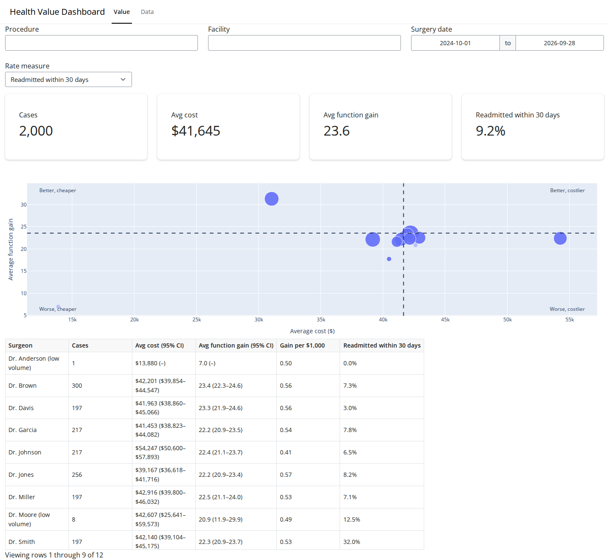
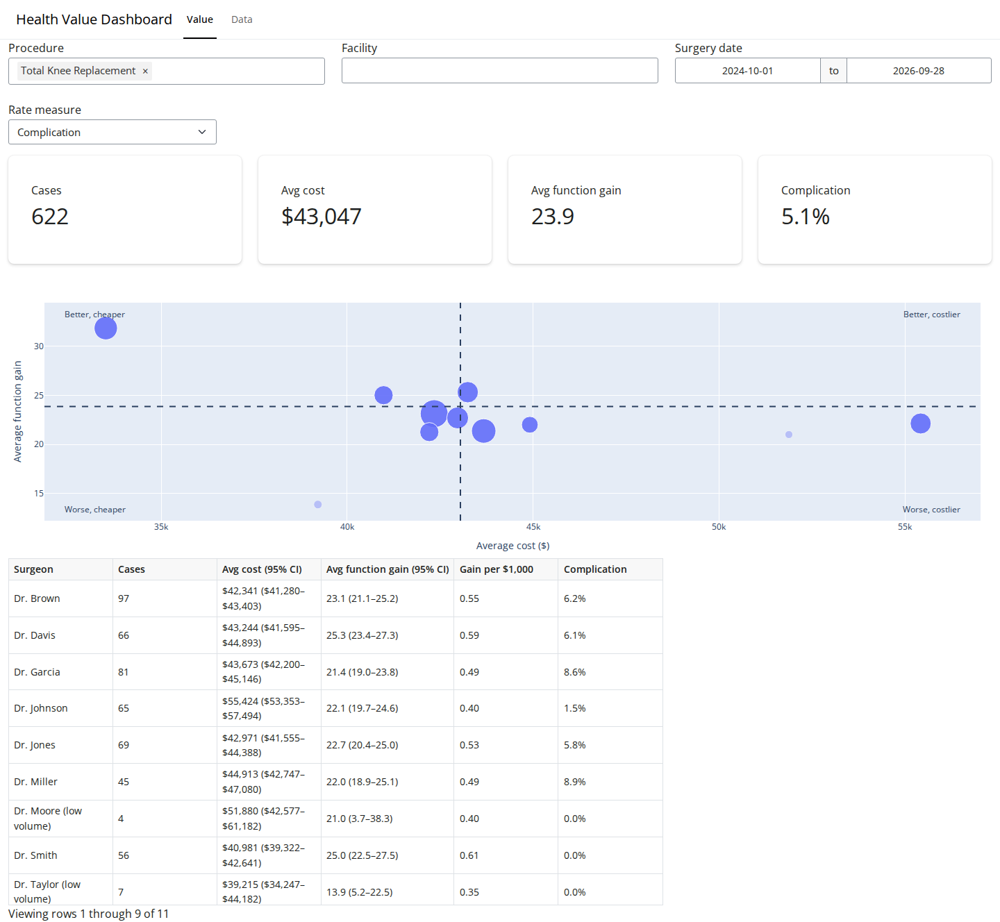
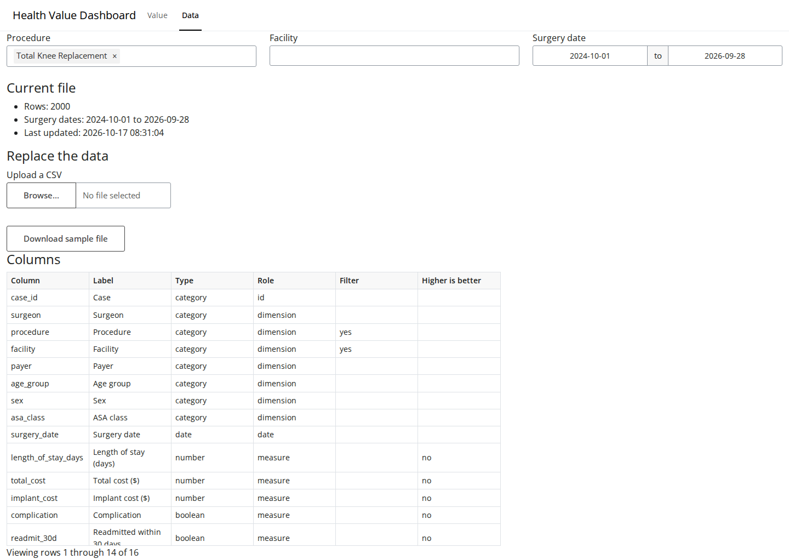

# Health Value Dashboard

A demo dashboard, built with Shiny for Python, that shows surgical value metrics such as outcomes, cost, and
surgeon comparisons. All data is made up and generated by a script in this repo.

```sh
make install
make run
```

Then open http://localhost:8000.

Docs: [design](docs/design.md) and [implementation plan](docs/plan.md).

## What it looks like

The Value tab shows headline numbers, a cost versus function gain value map, and a per-surgeon table. The Surgeons tab shows a funnel plot of each surgeon's rate against
control limits, and a quarterly trend for one surgeon against everyone else.



The filter bar narrows every number, the map, and the table. The rate measure picks which rate the table and
the last headline box show. Here the cases are filtered to total knee replacements, and the rate is complications.



The Data tab shows the current file, lets you upload a replacement CSV, and lists the expected columns.



To refresh these images, run `make screenshots`. The first time, install the browser with
`uv run playwright install chromium`.

## Run with Docker

Every merge to `main` publishes a new image to the GitHub container registry. `make docker-run-registry` pulls and
runs the newest one, no login needed.

```sh
make docker-run-registry
```

Then open http://localhost:8000. The app keeps its data in `.hvd-data/current.csv` in this folder, so uploaded
data survives restarts. Delete `.hvd-data/` to go back to the sample data.

To build and run your local changes instead, use `make docker-build` and `make docker-run-local`.

## Self-guided tour

`TOUR.md` is a step-by-step tour of how this project is built with Claude, from design to a published image.
To start it, open Terminal, run `mkdir -p ~/code && cd ~/code && claude`, type `/model sonnet`, and paste:

> I'm starting the Health Value Dashboard tour. If ~/code/health-value-dashboard doesn't exist, clone
> https://github.com/tahardi/health-value-dashboard there. Then read TOUR.md in that folder and guide me through
> it, starting where .tour-progress.md says I left off, or from the beginning if it doesn't exist.
